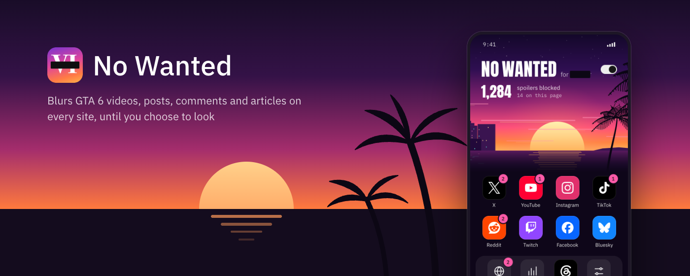

# No Wanted

A browser extension that blurs GTA 6 spoilers on every site, so you can stay online until you've played it. Videos, Shorts, Reels, TikToks, posts, comments, search results, headlines and articles about the game are blurred in place. A page that is entirely about the game gets one cover with a way back. Hidden videos are paused and muted.

- Click a blurred post and it asks before showing anything
- The channel or author stays readable, so you know whose post it is
- Block whole accounts from the menu, per platform
- Allow any website from the menu, and No Wanted leaves it alone
- Choose how much counts as a spoiler: the title only, the cast and map, or the whole series

Everything runs in your browser and it collects nothing. Once a day it downloads one small rules file with new words and site fixes (data only, no code) from nowanted.online. You can turn that off in Settings.

Website: https://nowanted.online

## Install

### Chrome, Edge, Brave, Arc and other Chromium browsers

The Chrome Web Store version is on the way. Until then, it takes a minute to install by hand:

1. Download `nowanted-chrome-1.0.0.zip` from the [Releases](../../releases) page and unzip it
2. Open `chrome://extensions` and turn on **Developer mode** (top right)
3. Click **Load unpacked** and pick the unzipped folder
4. Pin No Wanted from the puzzle-piece menu so its button stays in the toolbar
5. Reload any tabs that were already open

### Firefox

No Wanted is in review on Firefox Add-ons, and this section will link to it once it's live. To try it before then, download `nowanted-firefox-1.0.0.zip` from [Releases](../../releases), open `about:debugging#/runtime/this-firefox`, click **Load Temporary Add-on** and pick the zip. Firefox removes it again when it restarts.

### Safari

Coming soon for Mac, iPhone and iPad.

## Limits

- It reads text, not pictures. A thumbnail or clip with no title, caption, hashtag or link that names the game is not caught
- Sound in an unlabeled video is not caught either
- Site layouts change. If a site stops blurring whole posts, report it: bugs@nowanted.online

## Build

    node scripts/build.mjs

This writes `dist/nowanted-chrome-<version>.zip` and `dist/nowanted-firefox-<version>.zip`.

Fonts: IBM Plex Sans, IBM Plex Mono and Anton, SIL Open Font License (`fonts/`).

No Wanted is a fan project. It is not affiliated with Rockstar Games or Take-Two Interactive.
