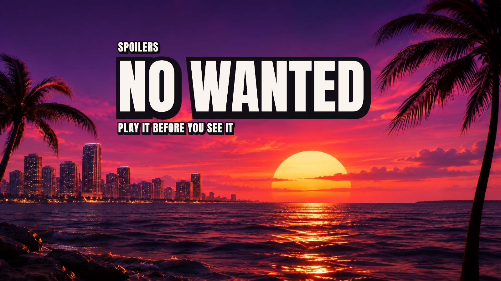
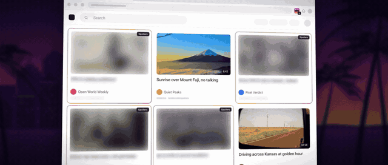
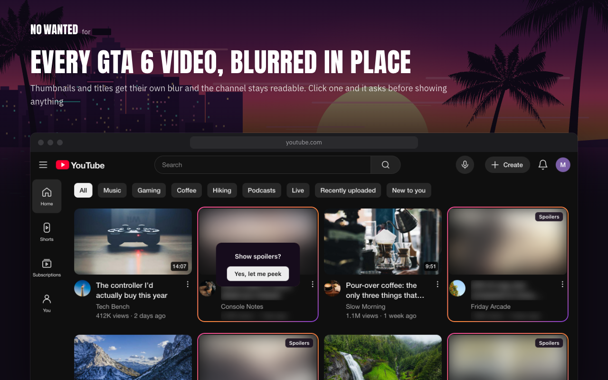
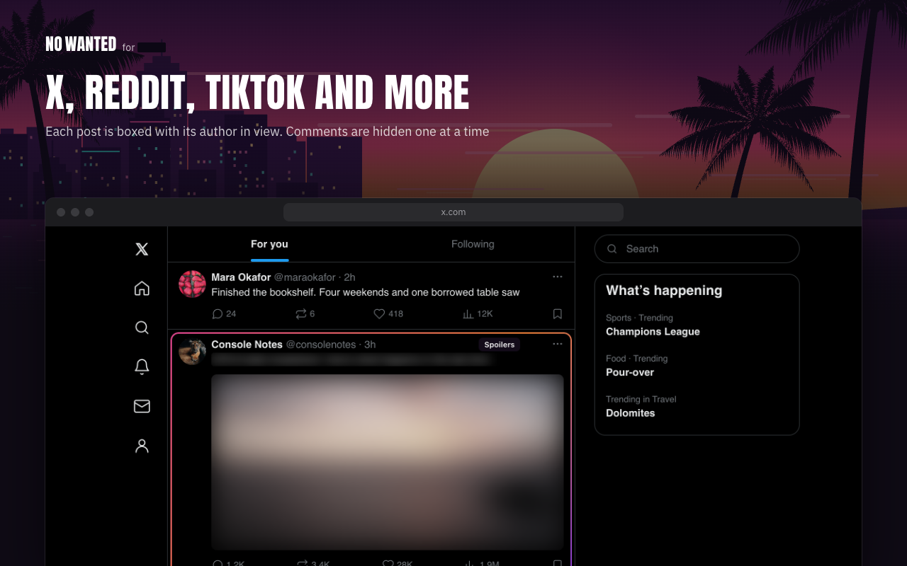
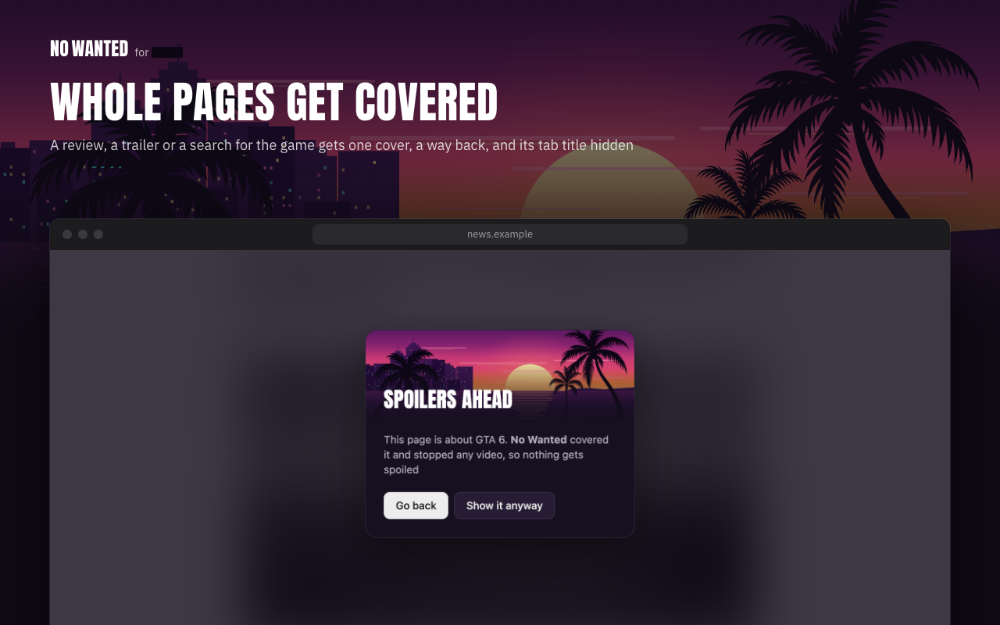
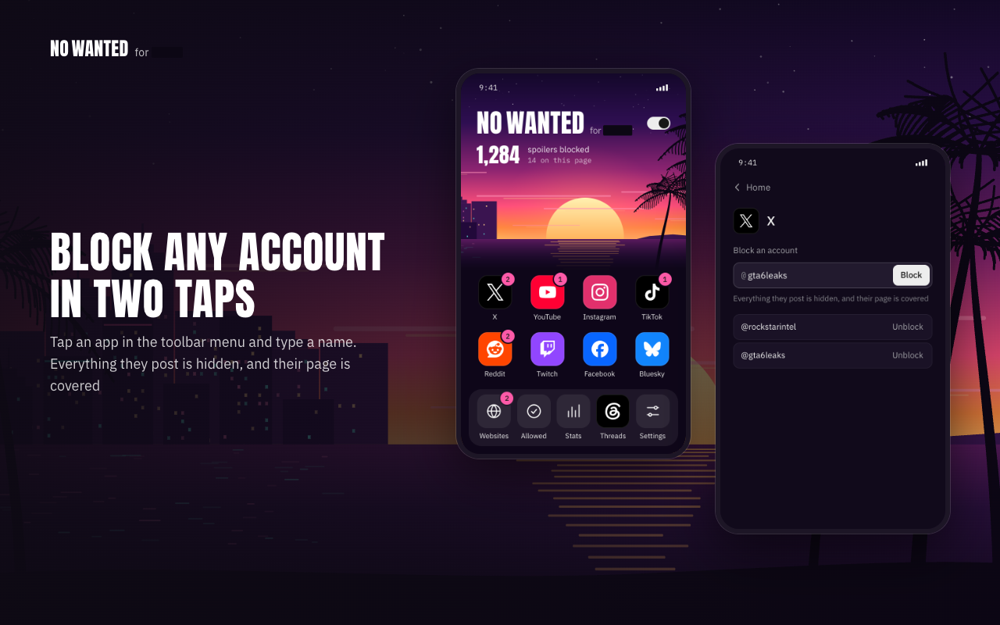
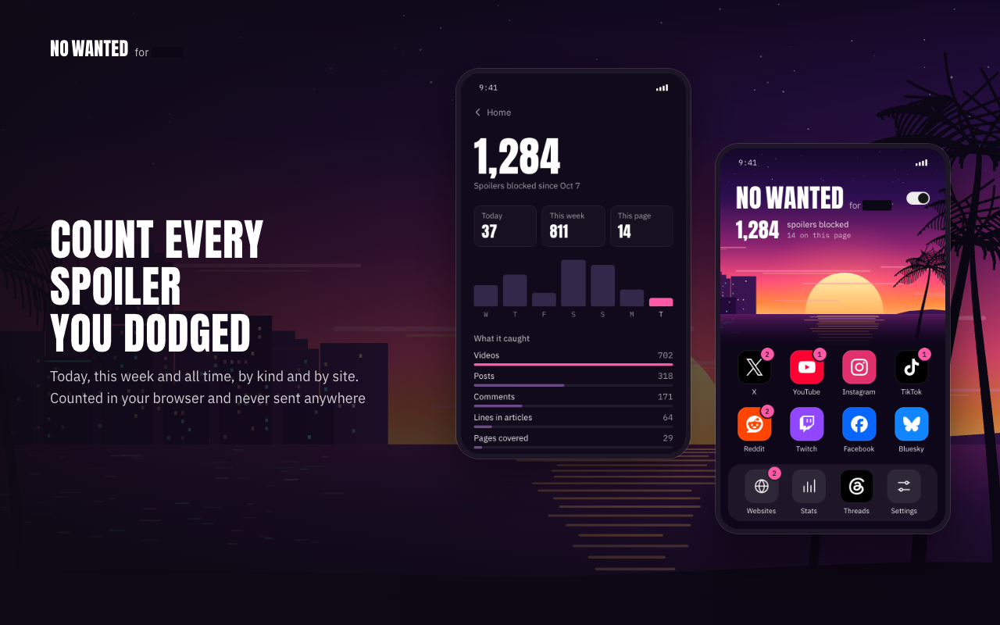

  

  <b>Play GTA 6 before you see it.</b> 
  A browser extension that blurs GTA 6 spoilers on every site, so you can stay online until you've played it.

  
  
  
  
  
  

  <a href="#install"><b>Install</b></a> &nbsp;·&nbsp;
  <a href="#what-it-does">What it does</a> &nbsp;·&nbsp;
  <a href="#privacy">Privacy</a> &nbsp;·&nbsp;
  <a href="https://nowanted.online">nowanted.online</a>

 

  

## What it does

Videos, Shorts, Reels, TikToks, posts, comments, search results, headlines and articles about the game are blurred right where they sit. The channel or author stays readable, so you know whose post it is. Click one and it asks before showing anything.

<table>
  <tr>
    <td width="50%"> <b>Feeds</b> Every GTA 6 video blurred in place, with the channel still in view</td>
    <td width="50%"> <b>Posts and comments</b> X, Reddit, TikTok, Instagram and more, one post or one comment at a time</td>
  </tr>
  <tr>
    <td width="50%"> <b>Whole pages</b> A review, a trailer or a search for the game gets one cover and a way back</td>
    <td width="50%"> <b>Block accounts</b> Type a name into the menu and everything that account posts is hidden</td>
  </tr>
</table>

- **It pauses and mutes** a blurred video, so a Short can't spoil it out loud
- **It catches every spelling:** GTA 6, GTA VI, GTA6, Grand Theft Auto VI, hashtags, and Russian, Chinese, Japanese, Korean and Arabic
- **You pick how much counts:** the title only, names and places too (the cast, Leonida, Vice City), or the whole series
- **Allow any website** from the menu, and No Wanted leaves it alone
- **It knows the big sites:** YouTube, X, Reddit, TikTok, Instagram, Facebook, Twitch, Bluesky, Google, Bing and DuckDuckGo. Everywhere else it finds the card or paragraph around the mention

   
  It counts every spoiler you dodged, in your browser only

## Install

| Browser | Status | |
| --- | --- | --- |
| Chrome, Edge, Brave, Arc | Store listing on the way | [Install by hand](#chrome-edge-brave-arc) in a minute |
| Firefox | In review on Firefox Add-ons | [Try it now](#firefox) |
| Safari on Mac, iPhone and iPad | Coming soon | |

### Chrome, Edge, Brave, Arc

1. Download **`nowanted-chrome-1.0.0.zip`** from the [Releases](../../releases) page and unzip it
2. Open <kbd>chrome://extensions</kbd> and turn on **Developer mode** (top right)
3. Click **Load unpacked** and pick the unzipped folder
4. Pin No Wanted from the puzzle-piece menu so its button stays in the toolbar
5. Reload any tabs that were already open

### Firefox

No Wanted is in review on Firefox Add-ons, and this section will link to it once it's live. To try it before then:

1. Download **`nowanted-firefox-1.0.0.zip`** from [Releases](../../releases)
2. Open <kbd>about:debugging#/runtime/this-firefox</kbd>
3. Click **Load Temporary Add-on** and pick the zip

Firefox removes it again when it restarts.

### Safari

Coming soon for Mac, iPhone and iPad.

## Privacy

No Wanted works inside your browser. It has no account, no analytics and no ads, and it collects nothing.

- The text of the pages you open is checked on your computer and never leaves it
- Once a day it downloads one small rules file from nowanted.online with new words and site fixes. It's data only, nothing in it runs as code, and the request carries nothing about you. You can switch it off in Settings
- Your stats stay on your computer. Removing the extension removes everything it saved

The full policy is at [nowanted.online/privacy](https://nowanted.online/privacy.html).

<b>What it can't catch</b>

 

- It reads text, not pictures. A thumbnail or clip with no title, caption, hashtag or link that names the game gets through
- Sound in an unlabeled video isn't caught either
- Site layouts change. If a site stops blurring whole posts, tell us at bugs@nowanted.online

<b>Build it yourself</b>

 

    node scripts/build.mjs

This writes `dist/nowanted-chrome-<version>.zip` and `dist/nowanted-firefox-<version>.zip`. You can also load this folder directly in Chrome with **Load unpacked**.

 

  Fonts: IBM Plex Sans, IBM Plex Mono and Anton, SIL Open Font License. 
  No Wanted is a fan project. It is not affiliated with Rockstar Games or Take-Two Interactive. Grand Theft Auto and GTA are their trademarks. 
  © 2026 No Wanted. All rights reserved.

